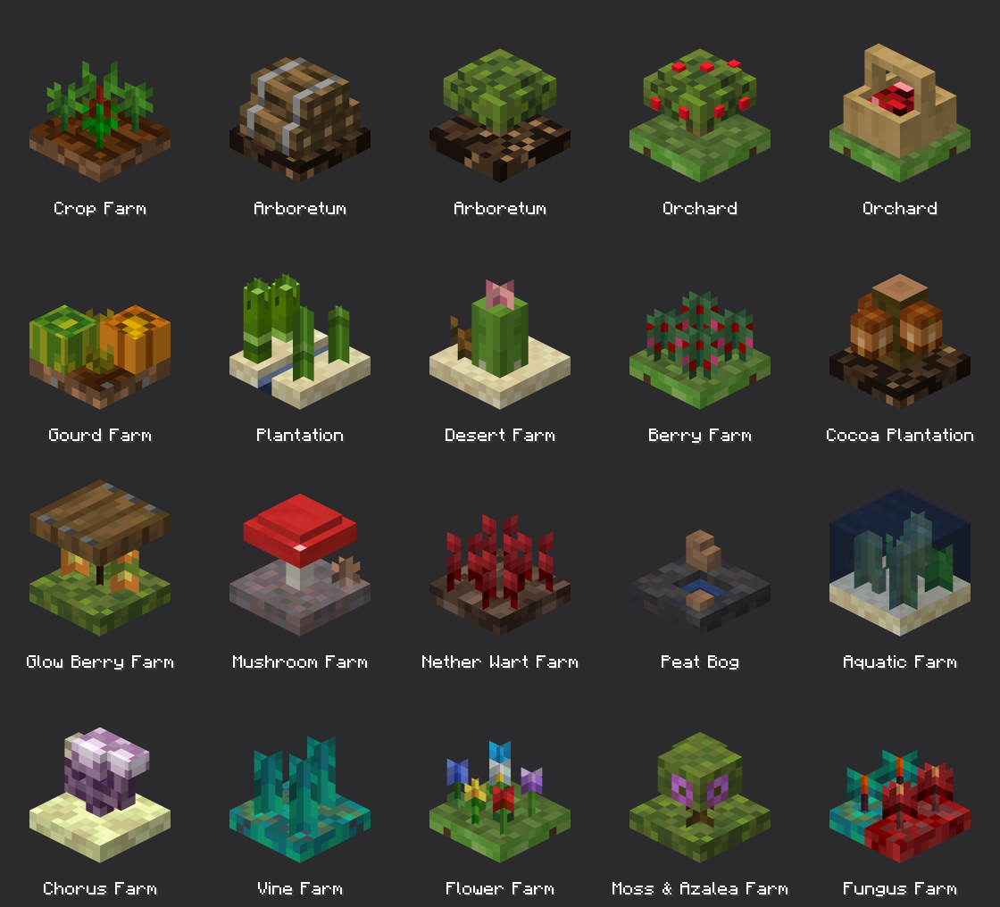

# Farm body concepts

Concept art for the planned farm blocks. This is a holding area for ideas, not shipped assets.

Every farm uses the same Forestry-style glass case. The case is a 4 px base, corner posts, glass
side panes and a 2 px cap with a glass top, painted from `farm_case.png`. Only the **body** inside
the case changes from farm to farm: a 10×10 bed, 2 px high, plus something planted on it. This
sheet checks that the design reads for every farm type before the first two farms are committed.



## The body envelope

- **Bed:** `[3,4,3]` to `[13,6,13]`.
- **Planting:** stays inside x/z 2–14 and y 6–15. The glass panes sit at 1 and 15, and the top
  glass at y 15.
- **Atlas:** each shipped farm paints its body from a single 32×32 atlas, `<farm>_body.png`,
  with UVs in 0–16 units (atlas px ÷ 2). The concepts here use vanilla textures instead.
- **Texel size:** every face samples its texture 1:1, so one texel is one model pixel, the
  same as everywhere else in Minecraft. Nothing is scaled. `check_texels` fails the run if any
  face would stretch or squeeze its texture.
  - **Blocks and plant strands** (beds, logs, cactus, caps, sugar cane, kelp, vines) crop
    vanilla textures 1:1.
  - **Small plants** are too large in vanilla to crop into a 10×10 bed, so they are redrawn at
    bed scale in their vanilla palettes (`SPRITES` in `concepts.py`). That covers the berry
    bush, nether wart, flowers, mushrooms, fungi, dead bush, bamboo leaves, gourd stem, cocoa
    pod, log end and apple.

## Lineup

The two labels that appear twice are alternatives to compare.

| Farm | Body | Status |
|---|---|---|
| Crop Farm | four crop-sprout crosses on farmland | farm shipped in #1469; this case model and `crop_farm_body.png` are on `farm-case-models` |
| Arboretum | a 3-2 pile of 3 px oak logs on Humus, with iron straps painted into the bark | alternative A |
| Arboretum | a mini tree on Humus (trunk, canopy, crown) | alternative B; the current model on `farm-case-models` |
| Orchard | the mini tree on grass with red apples in the foliage | alternative A |
| Orchard | a stripped-oak basket on grass, filled with `textures/apple_pile.png` | alternative B |
| Gourd Farm | a pumpkin and a melon with attached stems | planned |
| Plantation | sugar cane and bamboo either side of a water channel in sand | planned |
| Desert Farm | two cactus columns, a cactus flower and a dead bush | planned |
| Berry Farm | four sweet berry bushes on grass | planned |
| Cocoa Plantation | pods on a bare jungle log, with no leaves | planned |
| Glow Berry Farm | glow-berry vines hanging from a spruce trapdoor on a 1 px centre post, over a moss bed | planned; the trapdoor hides the vines from above |
| Mushroom Farm | a giant red mushroom on mycelium | planned |
| Nether Wart Farm | wart stalks with bulbs on soul sand | planned |
| Peat Bog | a mud bed with a water inset and stacked peat | planned; no plant |
| Aquatic Farm | kelp, seagrass and sea pickles under a full water volume | idea; needs a translucent layer |
| Chorus Farm | a branching chorus plant on end stone | idea |
| Vine Farm | twisting vines on warped nylium | idea |
| Flower Farm | six vanilla flowers on grass | idea |
| Moss & Azalea Farm | a flowering azalea and an azalea on moss | idea |
| Fungus Farm | half crimson and half warped nylium, each with its own fungus | idea |

**Decisions so far:**
- **No 2×2 Arboretum.** The plan is to add 1×1 versions of the trees that are 2×2-only in
  vanilla. The current Arboretum already plants any sapling that isn't flagged `requires_2x2`.
- **The Fungus Farm covers both Nether woods**, which is why its body is split in two.
- **The Cocoa body is pods on a log**, with no foliage.

## Regenerating

```bash
python3 -I design/concepts/farm-bodies/concepts.py
```

**Inputs:**
- **Renderer:** `../logistics-docs/tools/render_blocks.py`. Override the path with
  `LOGISTICS_DOCS_TOOLS`.
- **Vanilla textures:** extracted once into `.cache/` (git-ignored) from the 26.3 client jar in
  the Gradle cache. Override with `MC_CLIENT_JAR`. Vanilla textures are never committed.
- **PNG decoding:** the renderer's own decoder. It needs the `docs` commit that respects
  transparency in grayscale and RGB PNGs; without it, textures such as `attached_pumpkin_stem`
  render as solid squares.

**Outputs:**
- **`farm-concepts.png`:** the labelled contact sheet.
- **`models/<body>.json`:** each body as a plain block model with the elements only, no case.
  - Texture ids point at the vanilla or logistics textures.
  - The tints used in the concepts (grass, water, stems, sugar cane) are not saved, so those
    faces show grey.
  - The water's translucency is not saved either.
- **`textures/`:** every generated texture: the redrawn sprites, `strapped_log.png` and
  `apple_pile.png`. Each sprite sits at the top-left of its own 16×16 file. `models/` refers to
  them as `logistics:block/forestry/concept/<name>`.

Each body is one function in `concepts.py`, listed in `BODIES` with its label and model file
name.
